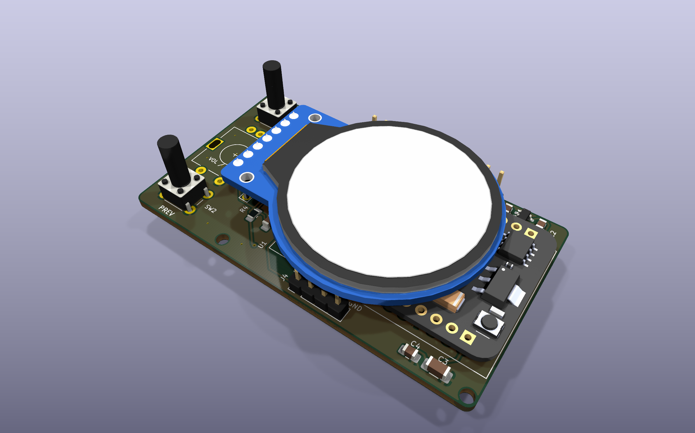

# MP3PlayerPCB v2: ESP32-CAM main board

v2 is a separate KiCad project. The v1 project in `../MP3PlayerPCB/` is left untouched.

## What's on the board

| Ref | Part | Notes |
|---|---|---|
| U1 | AI-Thinker ESP32-CAM | Soldered straight in on the standard 2.5 mm header spacer. **Remove the OV2640 camera**: it isn't used, and there's no room for it under the display. |
| U3 | PCF8574TS (SSOP-20), I2C 0x20 | Reads all six inputs. Polled; INT is unused. |
| U2 | AP2112K-3.3 | 600 mA LDO from the battery rail |
| J1 | GC9A01 1.28" round TFT | The display's 7 pins solder straight into the board. Pin names are on the **back** silkscreen. |
| SW1 / SW2 | 6x6 tact, 13 mm actuator | NEXT / PREV, under the lid button holes |
| SW3 | Alps EC11E encoder with switch, H20 | Volume / scroll; push = play/pause |
| SW4 | C&K OS102011MA1Q right-angle slide | Power. The lever pokes through the back wall. |
| SW5 | KMR2 tact | BOOT (pulls IO0 low) |
| J2 | 2-pin wire pads | From the TP4056 Type-C module's OUT+/OUT- (the module stays off-board, as in the CAD, because the case's USB-C hole is at its height) |
| J3 | 1x4 header | PROG: GND / TX(IO1) / RX(IO3) / IO0 |
| J4 | 1x4 header | Spare expander pins P5-P7 + GND (for example a third button) |

## Pin map (ESP32-CAM)

| GPIO | Use |
|---|---|
| 2 / 14 / 15 | Onboard microSD, SDMMC 1-bit (D0 / CLK / CMD). Not routed on this board. |
| 13 | TFT SCLK |
| 12 | TFT MOSI (strapping pin: nothing may pull it high at reset) |
| 0 | TFT DC + BOOT button, 10k pull-up |
| 3 (U0R) | I2C SDA, 4.7k pull-up |
| 1 (U0T) | I2C SCL, 4.7k pull-up |
| 4 | Unused (drives the module's flash LED) |
| 16 | Unused (PSRAM CS) |

TFT CS is tied low. TFT RST is a 10k/1uF power-on reset.

PCF8574: P0 ENC_A, P1 ENC_B, P2 ENC_SW, P3 NEXT, P4 PREV, P5-P7 to J4.

**Flashing:** hold BOOT, switch power off and on, then upload through J3 with a 3.3 V USB-UART adapter (its TX goes to RX). The I2C bus shares those two pins, so the serial debug console isn't available while running.

## Verification (KiCad 10.0.5)

- **ERC:** 0 errors. One warning: the PCF8574TS symbol differs from the KiCad 10 library copy.
- **DRC:** 0 errors, 0 unconnected, 0 schematic-parity issues. 16 warnings: the stock footprints came from the KiCad 7 library. *Update Footprints from Library* clears them.
- 2-layer, 1.6 mm board, 68.4 x 38.5 mm. 0.2 mm clearance, 0.25 mm signals, 0.3 mm 3V3, 0.4 mm battery rail. GND pours on both layers, with a copper keep-out under the ESP32 antenna.

## Fit against `CAD/Music Player Assembly`

The outline is the enclosure cavity minus 0.4 mm. The board's bottom face sits on the battery (z = -3.0 in the assembly frame).

Changes the enclosure needs:

1. Remove the encoder pedestal and the right-hand support block. Both were for the old module layout and now overlap the board.
2. Raise the back-wall power-switch slot by about 2 mm.
3. The display has about 0 mm of clearance over the ESP32 shield. Raise it about 1 mm, or order a 1.0 mm board.
4. Optionally add bosses for M2 holes H1 and H2.

Other things to check before ordering:

- Confirm the ESP32-CAM 3V3/5V row and the display header pin order against your actual parts.
- Trim the ESP32 header pins flush and insulate the board's underside from the LiPo.

`3d/*_placed.stpZ` are your ESP32-CAM and display models with their placement baked in.
