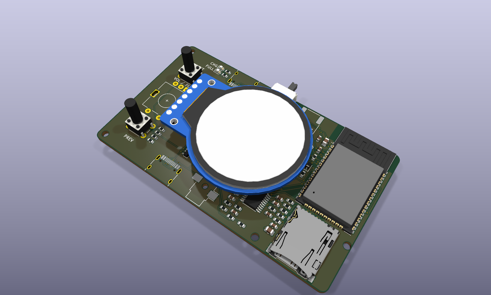

# MP3PlayerPCB v3: ESP32-WROVER main board

v3 is a separate KiCad project. `../MP3PlayerPCB_v2/` (ESP32-CAM carrier) is left untouched.

**Status: designed and checked in KiCad, not built.** Nothing here has been tested on hardware, and the firmware changes below are not done yet.

## What's on the board

| Ref | Part | Notes |
|---|---|---|
| U1 | ESP32-WROVER-E-N4R8 | Soldered directly. Classic ESP32, so Bluetooth A2DP still works. 4 MB flash, 8 MB PSRAM |
| J6 | Hirose DM3AT microSD | SDMMC 1-bit, same pins as the current firmware |
| U8 | PCM5102A DAC | I2S, generates its own clock, so no MCLK pin is needed |
| U9 | TPA6132A2 headphone amp | Ground-referenced, so no output capacitors. Set to -6 dB |
| J3 | USB-C, analog audio | Passive USB-C earbuds only (see below) |
| J4 | Same Sky SJ-3524-SMT | 3.5 mm headphone jack with plug detect |
| U2 | MCP73831 charger | 500 mA (R5 = 2k). Raise R5 for cells under 500 mAh |
| D4 / D5 | Red / green LED | Red while charging, green when full |
| Q1, D1 | Power path | On USB the load runs from USB and the battery only charges, so charge termination works |
| U5 | MAX17048 fuel gauge | I2C 0x36, wired straight to the cell |
| U3 / U4 | AP2112K-3.3 | Digital 3V3 / separate quiet analog rail that firmware can turn off |
| SW4 | C&K OS102011MA1Q | Power switch. Cuts the load only; charging still works when off |
| J2 | USB-C, charge + data | Charging, flashing and serial console |
| U6, Q2, Q3 | CH340C + auto-program | Flash over USB-C with no buttons or adapter |
| J1 | 1x7 socket, 2.54 mm | Plug-in header for the same GC9A01 module used on v2 |
| Q4 | Display power switch | Turns the panel and its always-on backlight off |
| SW1 / SW2 | 6x6 tact, 13 mm | NEXT / PREV, same spacing as v2 |
| SW3 | Alps EC11E + switch | Volume / scroll / press |
| SW5 / SW6 | KMR2 tact | BOOT / RESET |
| J5 | JST-PH 2-pin | LiPo. **Check your cell's polarity against the silkscreen first; JST leads are not standardized** |

Board: 86 x 50 mm, 4 layers (signal / GND / 3V3 / signal), all parts on the top side. 0.2 mm signals, 0.5 mm power, 0.6/0.3 mm vias, 0.15 mm clearance. Copper keep-out on all layers under the antenna, which sits outside the display's footprint.

## USB-C earbud compatibility

J3 is wired for USB-C Audio Accessory Mode: left and right on D-/D+, ground on the SBU pins.

- **Works:** passive (analog) USB-C earbuds and anything with a 3.5 mm plug.
- **Does not work:** digital USB-C earbuds with a built-in DAC, which is most of them, including many sold with phones. They need a USB host, and the classic ESP32 doesn't have one. The ESP32-S3 does, but it has no Bluetooth Classic, so A2DP would be lost.

## Pin map

| GPIO | Use | | GPIO | Use |
|---|---|---|---|---|
| 19 / 23 / 22 / 21 / 27 | TFT SCLK / MOSI / CS / DC / RST | | 25 / 26 / 13 | I2S LRCK / BCK / DOUT |
| 14 / 15 / 2 | SD CLK / CMD / D0 | | 12 | AUDIO_EN (high = analog on) |
| 32 / 33 | Encoder A / B | | 18 | TFT_PWR (high = panel off) |
| 36 | Encoder switch | | 4 / 5 | I2C SDA / SCL |
| 35 / 39 | NEXT / PREV | | 34 | HP_DET (low = earbuds in, either port) |
| 1 / 3 | UART0 to CH340C | | 0 | BOOT, keep as input at runtime |

## Firmware changes needed

Display, SD and encoder A/B pins are unchanged. `config.h` needs:

- Move `PIN_ENC_SW` 5 to 36, `PIN_BTN_NEXT` 18 to 35, `PIN_BTN_PREV` 4 to 39.
- Remove `PIN_BTN_PLAY` (GPIO 13 is now I2S) and map play/pause onto the encoder press.
- Remove `PIN_BATT_ADC` and read the MAX17048 over I2C instead.
- Add the wired audio path: I2S output, AUDIO_EN, HP_DET, and software volume (the DAC has none).
- GPIO 12 is a strapping pin. Only drive AUDIO_EN after boot.
- Before setting TFT_PWR high, set the TFT pins low or to inputs so the panel isn't back-powered. Re-run panel init after power-up.

## Verification (KiCad 10.0.5)

- **ERC:** 0 errors, 2 warnings (SBU pins deliberately tied to ground).
- **DRC:** 0 errors, 0 unconnected, 0 schematic-parity issues. 4 warnings: the stock USB-C footprints' silkscreen crosses the board edge, as edge connectors do.
- KiCad's exported netlist matches the design data on every named net.
- IC pinouts checked against manufacturer datasheets and, where KiCad has a symbol, against that too.
- WROVER footprint built from Espressif's land pattern (datasheet v2.4, Figure 15).

## Check before ordering

1. **J1 pin order** against your display module (VCC, GND, SCL, SDA, DC, CS, RST, carried over from v2).
2. **J4 tip switch:** the jack datasheet could not be retrieved. Confirm TN is the normally-closed tip contact, or plug detect on the 3.5 mm jack won't work.
3. **D6 / D7** must be bidirectional TVS diodes. A normal USB ESD part would clip the audio.
4. **Battery:** must have a built-in protection circuit. The board has no over-discharge or short-circuit cutoff.
5. **Assembly:** U9 (QFN) and U5 (DFN) can't reasonably be hand-soldered. Use PCBA or a hot plate and stencil.

## Enclosure

The existing case won't fit. A new one needs openings for J2 and SW4 (top edge), J3, J4 and J6 (bottom edge). The button, encoder and display spacing matches v2, so the lid layout carries over. The display now plugs into a socket, so it sits higher than v2 and is only held along one edge: add a printed support under its far side.

`U1`'s 3D model is a stretched WROOM stand-in (KiCad ships no WROVER model); it only affects renders.
